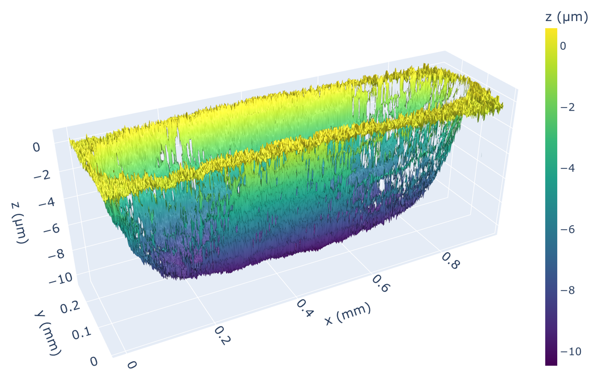
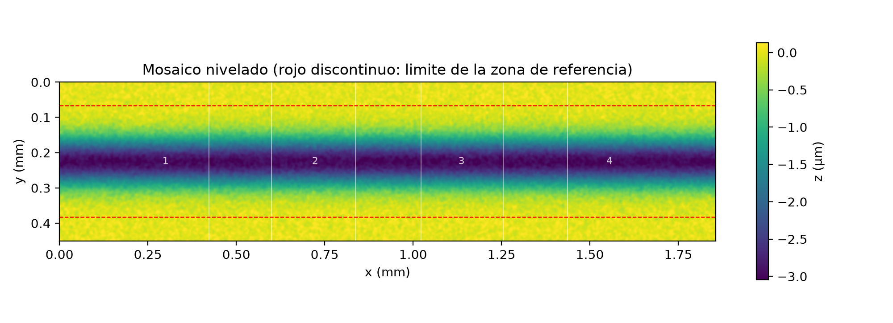
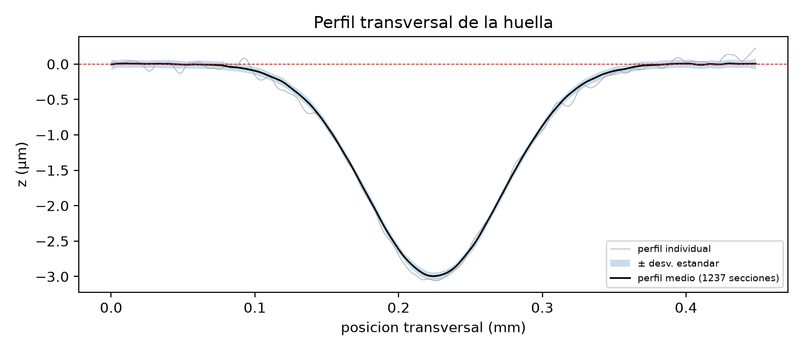
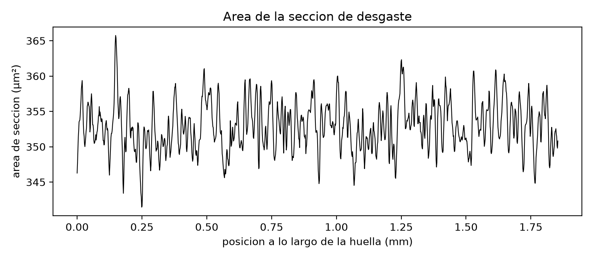
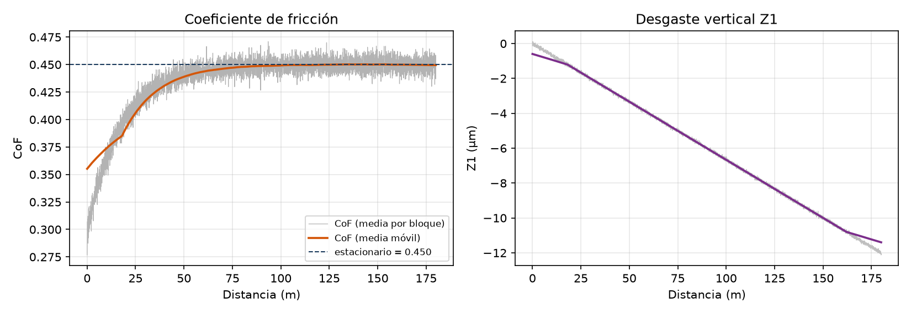

# Stitching de huellas de desgaste

Cose topografías ópticas de una huella de desgaste medidas en varios campos, calcula su volumen y su tasa de desgaste, y exporta los ensayos de fricción (`.tst`) a OriginLab. Pensado para ensayos reciprocantes (*block-on-flat* / *pin-on-flat* / *ball-on-plate*).

| Script | Qué hace |
|---|---|
| [`coser_huella.py`](coser_huella.py) | Une (*stitching*) varias topografías de perfilómetro óptico medidas a mano con solape, nivela el mosaico y calcula el **volumen de desgaste**, el **área de la sección** y la **tasa de desgaste específica k** (Archard). |
| [`exportar_origin_bof.py`](exportar_origin_bof.py) | Lee los ficheros binarios **`.tst`** del tribómetro, calcula **CoF**, fuerzas y desgaste vertical y exporta todo en formato listo para **OriginLab** (`.dat` con cabecera Long Name/Units/Comments, resumen de KPIs acumulativo y, opcionalmente, proyecto `.opju` con gráficas). |
| [`bof_core.py`](bof_core.py) | Módulo común: lector de `.tst` y motor de cálculo (lo usa `exportar_origin_bof.py`). |

<p align="center">
  
  <br><em>Huella real cosida a partir de 7 campos de perfilómetro confocal (~0,94 × 0,27 mm, ~10 µm de profundidad).</em>
</p>

Funcionan en **Windows, macOS y Linux**, en procesadores **x86-64 y ARM** (Apple Silicon incluido): son Python puro con numpy/scipy, sin código compilado propio.

---

## Instalación

Requiere Python ≥ 3.9.

```bash
git clone https://github.com/sgomez-p/stitching-huellas-desgaste.git
cd stitching-huellas-desgaste
pip install -r requirements.txt
```

En Linux, las ventanas necesitan tkinter (`sudo apt install python3-tk` en Debian/Ubuntu).

Para probar sin datos reales:

```bash
python ejemplos/generar_datos_sinteticos.py
```

genera `ejemplos/campos/` (4 campos solapados de una huella) y `ejemplos/ensayo_sintetico.tst`.

---

## `coser_huella.py` — stitching de topografías y volumen de desgaste

Cuando la huella de desgaste es más larga que el campo del objetivo, se mide en varios campos moviendo la platina XY a mano. El script:

1. **Lee** los campos (`.plu` Sensofar, `.gsf` Gwyddion, matrices ASCII, XYZ, `.npy`).
2. **Quita picos** aislados (*outliers* típicos de confocal/interferometría).
3. **Alinea en XY** cada campo con el vecino que mejor encaja mediante correlación cruzada normalizada enmascarada (tolera puntos no medidos). La posición se busca con la textura a escala media y se valida con la textura fina, para no confundir huellas parecidas.
4. **Ajusta Z** (offset y, opcionalmente, inclinación) en las zonas de solape.
5. **Funde** los campos con pesos decrecientes hacia los bordes (*feathering*).
6. **Nivela** el mosaico con un plano robusto ajustado a las bandas de superficie **sin desgastar** a ambos lados de la huella.
7. Calcula **V⁻** (volumen desgastado), **V⁺** (material apilado), profundidad máxima y el **área de la sección** a lo largo de la huella, con y sin umbral de ruido (k·σ de la referencia).
8. Si se dan carga, distancia y carrera, calcula **k = A·L / (Fn·d)** en ×10⁻⁶ mm³/(N·m).

### Uso

```bash
python coser_huella.py                    # ventanas para elegir ficheros y parámetros
python coser_huella.py CARPETA            # todos los campos de una carpeta
python coser_huella.py c01.plu c02.plu c03.plu --barrido x --carga 2 --distancia 1000 --carrera 30000
```

| Opción | Descripción |
|---|---|
| `--barrido auto\|x\|y` | Dirección en que avanzan los campos (x: izquierda→derecha, y: arriba→abajo) |
| `--pixel UM` | Tamaño de píxel (µm), solo si el fichero no lo incluye |
| `--ref-frac 0.15` | Fracción de cada borde usada como referencia sin desgaste |
| `--ref-eje auto\|x\|y` | Bordes de referencia: `y` = arriba/abajo, `x` = izquierda/derecha |
| `--umbral 3` | Umbral de volumen en múltiplos de σ de la referencia |
| `--tilt` | Corrige también la inclinación relativa entre campos |
| `--carga N` | Carga normal (N). Si no se da, se intenta leer del nombre (`…-2N-…`, `CARGA 0.5N`) |
| `--distancia M` | Distancia total deslizada (m) |
| `--carrera UM` | Carrera / longitud de la huella (µm) |
| `--nombre`, `--salida` | Nombre de la huella y carpeta de resultados |
| `--forzar` | Cose aunque la correlación sea baja (no recomendado) |
| `--sin-3d`, `--sin-filtro` | No abrir el visor 3D / no quitar picos |

**Cómo medir los campos:** mismo objetivo y rango Z en todos; 25-30 % de solape entre campos vecinos; superficie sin desgastar a ambos lados de la huella. El orden y la dirección dan igual: basta con que cada campo solape con alguno anterior (orden natural del nombre: `…-01`, `…-02`, …).

### Salidas (en `CARPETA/NOMBRE/`)

| Fichero | Contenido |
|---|---|
| `*_mosaico.png` | Mapa de alturas nivelado con el contorno de cada campo y las bandas de referencia |
| `*_mosaico_3d.png` / `*_mosaico_3d.html` | Vista 3D estática e interactiva (plotly, funciona sin internet) |
| `*_perfil_central.png`, `*_perfil_medio.csv` | Perfil transversal medio ± desviación |
| `*_area_seccion.csv/.png` | Área de la sección y k a lo largo de la huella |
| `*_resumen.csv` | Una fila con áreas medias, k y profundidad máxima |
| `*_mosaico.gsf`, `*_mosaico_matriz.txt`, `*_mosaico.npy` | Mosaico para Gwyddion / MountainsMap / Python |
| `*_informe.txt` | Posiciones, calidad de cada unión (NCC), offsets y volúmenes |

### Ejemplo

*Datos sintéticos generados con `ejemplos/generar_datos_sinteticos.py`: 4 campos solapados de una huella de 3 µm de profundidad.*



| Perfil transversal medio | Área de la sección a lo largo de la huella |
|---|---|
|  |  |

---

## `exportar_origin_bof.py` — exportación de ensayos `.tst` a OriginLab

Ejecuta el script, añade los `.tst` en la ventana, rellena los metadatos (lote, tratamiento, zona, carga, velocidad media, frecuencia, ventana de suavizado, fracción estacionaria) y pulsa **Exportar**.

```bash
python exportar_origin_bof.py
```

Para cada ensayo genera, junto al `.tst`:

- **`<id>_origin.dat`** — serie temporal completa (tiempo, distancia, Fz, Fx, |Fx|, Z1, CoF y medias móviles) con cabecera de 3 filas que Origin reconoce al importar.
- **`<id>_origin_decN.dat`** — la misma serie diezmada (opcional).
- **`<id>.opju`** — proyecto Origin con la hoja y gráficas de CoF y Z1 (opcional; requiere OriginLab ≥ 2021 y `pip install originpro`, **solo Windows**).

Y un **resumen de KPIs** acumulativo (`.dat` + `.json`): una fila por ensayo con CoF estacionario, CoF por tercios, fuerzas medias, ΔZ1, tasa de desgaste vertical, distancia de rodaje, etc. Reexportar un ensayo actualiza su fila en vez de duplicarla.

### Ejemplo

*Ensayo sintético de 10 min a 5 Hz y 2 N: rodaje inicial del CoF hasta el régimen estacionario y desgaste vertical progresivo.*



### Formato `.tst`

Registros binarios de 33 bytes (little-endian): `Fx`, `Fz`, `Z1` (float64), contador (2 × int32, tiempo = contador / 10 000 s) y separador `0x24`. El lector localiza automáticamente el bloque de datos válido más largo dentro del fichero.

### Cálculos principales (`bof_core.calcular`)

- Distancia: `d = v_media · t`
- CoF instantáneo `|Fx| / Fz` y medias móviles con ventana en **segundos** (independiente de la frecuencia de adquisición)
- CoF estacionario: media de la fracción final del ensayo (`pct_estacionario`)
- Fin de rodaje: primer punto donde el CoF suavizado alcanza el 95 % del estacionario
- Tasa de desgaste vertical: `|ΔZ1| / d`

---

## Licencia

[MIT](LICENSE)
